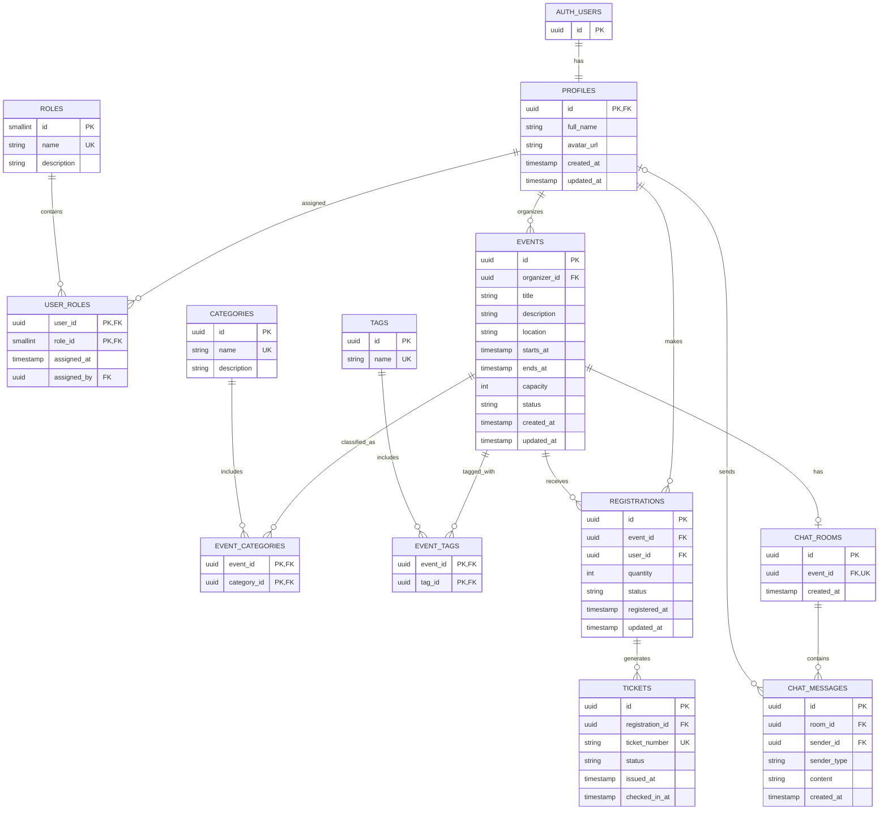

# Meet Hub

MeetHub is a full-stack event management platform that allows users to create and manage events, register and receive tickets, chat with attendees through a scripted chatbot, and view organizer analytics.

## Project Structure

- `Backend/` - backend application
- `Frontend/` - frontend application

**User Roles**
**A. Attendee**
An attendee can:
1. Register and log in.
2. Browse available events.
3. View event details.
4. Register for an event.
5. Receive and view tickets.
6. Chat with the FAQ chatbot.
7. Communicate with other attendees, if attendee-to-attendee chat is implemented.

**B. Organizer**
An organizer can:
1. Log in to the application.
2. Create new events.
3. View all events they are authorized to manage.
4. Update or delete events.
5. View attendee registrations.
6. Access the analytics dashboard.
7. Monitor registration statistics.

  # M E E T H U B

User (Attendee / Organizer) → React Frontend → Event Pages / Chat UI / Dashboard → REST APIs / Socket.IO → Node.js + Express.js Backend → Authentication / Event Management / Registration & Ticketing / Chatbot / Analytics → Mongoose → MongoDB (Users / Events / Registrations / Tickets)

## 1. Authentication Flow

User → Register / Login Page → React Frontend → Send Credentials to Backend → Express API → Validate Credentials → Hash Password (Registration) / Verify Password (Login) → Save or Retrieve User from MongoDB → Generate JWT / Session → Return Authentication Response → Check User Permissions → Attendee / Organizer → Access Authorized Features

## 2. Event Management Flow

Organizer → Event Management Page → Enter Event Details → Submit Event Form → React Frontend → POST Request (REST API) → Express Backend → Authenticate User → Check Organizer Permissions → Validate Event Information → Mongoose Model → Save Event in MongoDB → Return Response to Frontend → Display Created Event

## 3. Event Registration Flow

Attendee → Browse Events Page → Select an Event → View Event Details → Click Register → React Frontend → Send Registration Request (REST API) → Express Backend → Authenticate Attendee → Validate Event → Check Event Availability → Check for Duplicate Registration → Create Registration Record → Mongoose Model → Save Registration in MongoDB → Return Registration Confirmation → Display Confirmation to Attendee

## 4. Ticketing Flow

Successful Registration → Generate Unique Ticket ID → Associate Ticket with Attendee, Event, and Registration → Save Ticket Information in MongoDB → Return Ticket Details to Frontend → Display Ticket to Attendee → Attendee Views or Retrieves Ticket

## 5. Real-Time Chatbot Flow

Attendee → Open Chat UI → React Frontend → Socket.IO Client → Socket.IO Server (Node.js) → Receive Message → Match Message Against Predefined FAQs → Generate Scripted Response → Emit Response Through Socket.IO → React Frontend → Display Chatbot Reply

## 6. Analytics Dashboard Flow

Organizer → Open Dashboard → React Frontend → Send Analytics Request (REST API) → Express Backend → Authenticate Organizer → Verify Permissions → Query MongoDB Using Aggregation → Calculate Total Events and Registrations per Event → Return Analytics Data → React Dashboard → Display Charts, Tables, and Statistics

## Database Architecture

### Entity Relationship Diagram (ERD)

The following diagram represents the proposed database schema for MeetHub.

### Tables Overview

| Table | Purpose |
|---|---|
| `profiles` | Stores application-specific user details |
| `roles` | Defines Admin, Organizer, and Attendee roles |
| `user_roles` | Maps users to roles and records role assignments |
| `events` | Stores event information, schedules, status, and capacity |
| `categories` | Stores broad event classifications |
| `event_categories` | Links events to categories |
| `tags` | Stores reusable event keywords |
| `event_tags` | Links events to tags |
| `registrations` | Records attendee registrations and seat quantities |
| `tickets` | Stores individual tickets and check-in status |
| `chat_rooms` | Associates an event with its chat room |
| `chat_messages` | Stores attendee messages and chatbot responses |

